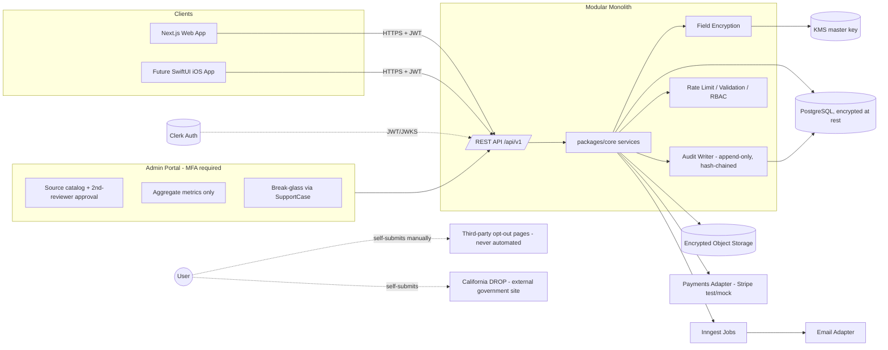

# Architecture

Modular monolith: Next.js (App Router, TS) with business logic in framework-independent `packages/core`, exposed via versioned REST `/api/v1/*` (Zod-validated, OpenAPI-generated) so a future SwiftUI app shares all logic.



## Key decisions
- **Encryption:** AES-256-GCM per field, per-user data key wrapped by KMS master key; AAD binds ciphertext to table/column/row. Account deletion destroys the user key (crypto-shredding).
- **Audit:** append-only table (DB trigger blocks UPDATE/DELETE), hash-chained, metadata redacted before write.
- **RBAC:** user, support, compliance_admin, system_admin. Admins cannot search users by attributes; account access only via SupportCase + time-limited audited AdminAccessGrant.
- **Sources:** versioned; creator cannot approve own change; only AVAILABLE/MANUAL_ONLY visible to users.
- **URL validation:** https only, hostname must match the source's approved domain, no credentials, no private IPs; server never fetches user-supplied URLs.
- **Logging:** pino with redaction allowlist; Sentry `beforeSend` scrubbing.

## Folder structure
```
apps/web/            Next.js app: (marketing) (app) (admin) api/v1, components/ui, e2e
packages/core        domain services, state machine, templates, URL validator
packages/db          prisma schema, migrations, seed
packages/crypto      field encryption, key wrapping, hashing
packages/audit       audit writer + redaction
packages/adapters    email, storage, payments, kms, ratelimit (real + mock)
packages/api-contract Zod schemas + OpenAPI
packages/config      env validation, feature flags, tsconfig/eslint
docs/                prd, architecture, threat-model, api, ios-integration, compliance-review, security-checklist, retention-schedule, deployment
```

## Phases
1. Design (this doc set). 2. Bootstrap (monorepo, tooling, auth scaffold, shell). 3. Core MVP (crypto/audit -> onboarding/profile -> sources/admin -> listings -> requests -> evidence -> reminders -> dashboard -> California -> export/delete -> support/billing -> marketing). 4. Security & quality (threat model, authz tests, a11y, E2E, seed, deployment).
